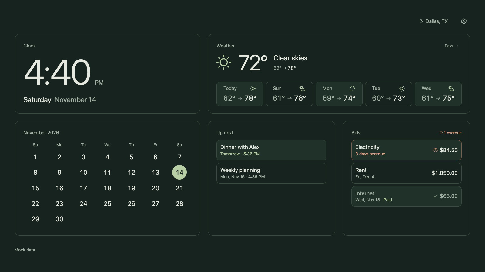
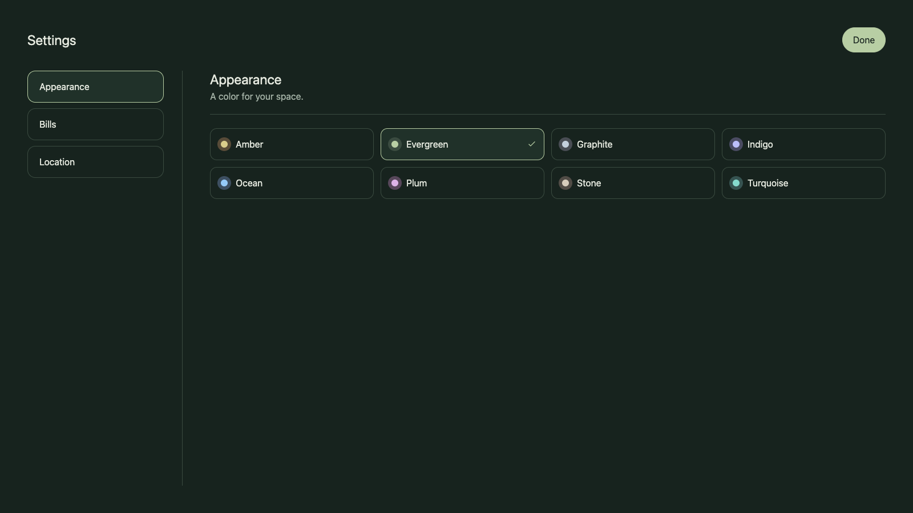

# Everyday

A quiet little dashboard for the things you check every day: the time, the weather, what's coming up, and which bills are due.

Built with **Svelte + TypeScript + Go**, for a browser on your desk today and a Raspberry Pi on the wall next. No database, paid dashboard service, or touchscreen needed.



*Screenshots use built-in mock data. All events, bill names, and amounts are fictional; no personal calendar entries or holidays are included.*

> **Local-first, for now.** Run the browser and server on the same computer. There is no login yet: don't publish Everyday to the internet or expose it to your network. The Pi instructions keep everything on the Pi.

## Start here

- **Try it on your computer:** [Quick start](#quick-start).
- **Put it on a display:** [Do I need a touchscreen?](#do-i-need-a-touchscreen) and the [Raspberry Pi guide](docs/raspberry-pi.md).
- **Customize it:** [Make it yours](#make-it-yours).
- **Dig into the details:** [Configuration and technical reference](docs/reference.md).

## What's on the dashboard?

| Widget | At a glance |
| --- | --- |
| Clock | Local time, weekday, and date |
| Weather | Current conditions, weather icons, and low → high temperatures; switch between daily and hourly forecasts |
| Calendar | The current month, or the current week when space is tight |
| Up next | Upcoming events from Google Calendar |
| Bills | Monthly reminders, overdue indicators, and paid marks |

The layout is fixed and landscape-only. Widgets adapt to their space: the forecast shows up to five days, and lists show as many whole cards as fit. Bills are reminders you enter yourself, not bank data or automatic payments.

## Quick start

### 1. Get the tools

You'll need **Git**, **Make**, **Node.js 22.18+** with npm, and **Go 1.22+**. Node 24 LTS is a suitable choice. Check your installed versions:

```sh
git --version
make --version
node --version
npm --version
go version
```

On macOS, if you already use Homebrew, `brew install node@24 go` installs the language tools; follow Homebrew's instructions to put Node on your PATH. Git and Make are available through Apple's Command Line Tools (`xcode-select --install`). Otherwise, use the official [Node.js](https://nodejs.org/en/download) and [Go](https://go.dev/doc/install) installation guides.

### 2. Download and run

```sh
git clone https://github.com/luckstrike/everyday.git
cd everyday
make install
make run
```

Open **http://127.0.0.1:8080** in a browser **on that same computer**. Leave the terminal running; **Ctrl-C** stops the server.

`make run` builds the frontend and Go binary, then starts one Go server for both the dashboard and API. Vite isn't running. The first build may take a little longer.

Weather starts with Dallas, TX. It's normal for Up next to be unconnected and Bills to be empty until you set them up. You don't need Google credentials just to try it.

### Just looking? Try the demo

Stop the server first, then run:

```sh
EVERYDAY_MOCK=1 make run
```

Open the same address for sample weather, fictional events, and sample bills—the data used in these screenshots. Bills and location editing are disabled in demo mode. Stop it and run plain `make run` to return to live sources; if you previously exported `EVERYDAY_MOCK`, unset it first.

## Make it yours

Click the **gear** in the top-right corner to open Settings. Choose **Done** or press **Escape** to return; Settings also closes after 90 seconds without activity.

### Choose a color

Open **Settings → Appearance** and pick one of eight themes. The choice is saved in that browser, so choose it again when you move to a different device or browser profile.



### Set your weather location

Click the location name above the dashboard, or open **Settings → Location**. Search for a city or postal code, choose the matching region, and save. Weather refreshes without a restart; no weather API key is needed for this non-commercial project.

This changes the **weather location only**. The clock and event times use the browser's timezone, so set the display computer's timezone correctly too. Environment-variable location overrides lock the location editor; see the [configuration reference](docs/reference.md#configure).

### Add your bills

In **Settings → Bills**, add a name, monthly due day, and amount—or choose **Amount varies**. Use the circle next to a bill to mark it paid for its displayed due date. Paid marks reset as the next month's bill comes around; unpaid tracked bills stay overdue until settled.

Everything is saved locally. No banking connection is involved, and marking a bill paid here does **not** pay it. See [bill behavior and file format](docs/reference.md#bills) for month-end handling and overdue details.

### Connect Google Calendar (optional)

This is the one step that takes a little patience: you create your own Google OAuth client and grant read-only calendar access.

1. Follow the [Google Calendar setup guide](docs/reference.md#connect-google-calendar) to create a **Desktop app** client and save its JSON file outside this repository.
2. From the project directory, run:

   ```sh
   make google-auth ARGS="-client-file /absolute/path/to/client.json"
   ```

3. Approve access in the browser, then restart the dashboard server.

Everyday follows the calendars selected in Google Calendar's sidebar. See [which calendars show](docs/reference.md#which-calendars-show) to exclude or pin specific calendars. Google's Testing mode can cause sign-in to expire after seven days for these permissions; the setup guide explains this.

## Do I need a touchscreen?

**Nope. Start with a monitor or TV you already have.** Touch is optional; a mouse and keyboard work too. A display being LED or LCD doesn't tell you whether it supports touch.

For a first Pi experiment, use a landscape HDMI display, the right cable for your Pi, and a keyboard/mouse for setup. Open Everyday in the Pi's browser and use fullscreen. You can leave the dashboard showing without an input device, but you'll need a way to interact when changing Settings or marking bills paid.

```text
Raspberry Pi
  ├── Go server: 127.0.0.1:8080
  └── Chromium → the same local address → HDMI monitor / TV
```

**[Follow the Raspberry Pi guide →](docs/raspberry-pi.md)**

The app has been developed and checked on macOS. The Pi guide is an initial manual setup path, **not a claim of hardware-tested support**. Start at a desk before buying a dedicated display or mounting anything.

## Your data and backups

Bills, location settings, and Google credentials live outside the repository:

| System | Default directory |
| --- | --- |
| macOS | `~/Library/Application Support/everyday/` |
| Linux / Raspberry Pi OS | `~/.config/everyday/` (or `$XDG_CONFIG_HOME/everyday/` when set) |

| File | Keep it for… |
| --- | --- |
| `config.json` | Saved weather location and calendar filtering |
| `bills.json` | Bills and their paid/tracking state |
| `google.json` | Google sign-in credentials—**keep this private** |

Files appear as you use each feature; not every setup has all three. See [path overrides](docs/reference.md#configure) if you've customized their locations. Stop the server before copying files for backup or restore, and keep the Google file out of Git, screenshots, and public backups. The theme is stored separately in your browser.

## Everyday commands

Run these from the project directory:

| Command | Use it for |
| --- | --- |
| `make install` | Install the locked frontend dependencies |
| `make run` | Build and run the local dashboard at port 8080 |
| `make build` | Build `build/everyday` and `frontend/dist/` without starting them |
| `./build/everyday -web-dir ./frontend/dist` | Start an existing build without rebuilding |
| `make dev` | Frontend hot reload at port 5173, with the API at port 8080 |
| `make google-auth` | Sign in again using a previously saved Google client |
| `make check` | Go race tests and vet, Svelte/TypeScript checks, and frontend behavior tests |

Don't run `make dev` and `make run` together: both need port 8080. The binary needs the complete `frontend/dist/` folder, including `assets/`. Node and Go are build tools, not runtime requirements for an existing build on a compatible OS/CPU. Use `GO=/absolute/path/to/go make run` to select another Go installation.

## Something not working?

| Symptom | Try this |
| --- | --- |
| Missing tool / unsupported Node version | Check the versions in step 1; reopen your terminal after installing tools |
| `address already in use` | Stop the other Everyday server with Ctrl-C; development and built modes share port 8080 |
| Missing frontend / `index.html` | Run `make build`, then start from the project directory with the documented `-web-dir` |
| Browser cannot connect | Keep the server running and use the browser on the same computer; `127.0.0.1` isn't your Pi's network address |
| Weather or calendar unavailable | Check internet access and the server log; failed refreshes retry automatically |
| Google Calendar stops working | Re-run `make google-auth`, restart the server, and check OAuth publishing status in the setup guide |
| Bills unavailable | Open Settings → Bills for the file error; back up an existing file before replacing it |
| Wrong clock or event time | Check the display computer's date, time, and timezone—not the weather location |

On macOS, adjust display sleep settings or run `caffeinate -d` in another terminal for a wall session. On the Pi, see the [display checklist](docs/raspberry-pi.md#before-you-call-it-a-wall-appliance).

## What's next?

The `v1.0.0` tag marks the first local dashboard release. These setup guides document that local-first app; they don't introduce login, cloud hosting, or automatic Pi installation.

Next comes real-world use: an overnight run, network recovery, restart/persistence checks, and physical display legibility. Remote access/authentication, calendar selection in Settings, and a verified Pi appliance setup remain future work.

For architecture, API endpoints, configuration, and deferred prototype features, see the [technical reference](docs/reference.md#architecture).
